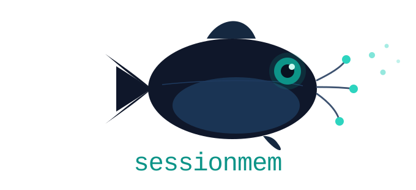

# sessionmem

<p align="center">
  
</p>

<p align="center">
  <a href="https://www.npmjs.com/package/sessionmem"></a>
  <a href="https://github.com/catfish-1234/sessionmem/blob/main/LICENSE"></a>
</p>

**Project memory between sessions, stored on your machine.**

```
New session. Claude starts fresh.

WITHOUT sessionmem:
  You explain the stack. The JWT bug from last week.
  The Stripe migration that's halfway done. The billing code to stay away from.
  Same questions. Different day.

WITH sessionmem:
  [warning] JWT blacklist must be checked before issuing new tokens. Fixed PR #47.
  [decision] Stripe migration ~50% done. Do NOT use /lib/billing-v1.
  [fact] Stack: TypeScript, Next.js, Postgres.

  Claude: "Looks like you're mid-Stripe migration. Where do you want to pick up?"
```

`sessionmem` is an MCP server that stores decisions, warnings, and project context across sessions. Claude Code hooks capture supported tool events and load relevant memories automatically. Other hosts use its MCP tools and installed instructions; session automation depends on the host. It works with Claude Code, Cursor, Cline, Codex, Windsurf, and other [MCP](https://modelcontextprotocol.io) hosts.

By default, everything stays on your machine. You don't need an account or a cloud service. Data only leaves your computer if you enable sharing or cloud summarization.

---

## Quickstart

You need a terminal (Command Prompt, Terminal, or PowerShell) and [Node.js](https://nodejs.org), version 20.19+ on the Node 20 line, or 22.13+. Node 22 LTS is recommended. No programming experience is required.

### 1. Install sessionmem

```bash
npm install -g sessionmem
```

### 2. Register it with your AI tool

Run this in your project folder after configuring your AI tool (Claude Code, Cursor, etc.):

```bash
sessionmem install
# From a plain terminal, choose the host explicitly when needed:
sessionmem install --adapter claude-code
# Other names: cursor, cline, codex, windsurf, antigravity, qcoder, generic
```

This initializes the database and, for supported adapters:

- Registers `sessionmem` with your AI tool's MCP host so the host can start it automatically.
- Creates `~/.sessionmem/config.json` with secret redaction enabled and a 90-day retention window, if the file doesn't already exist.
- Adds instructions to the selected host's guidance file, such as `~/.claude/CLAUDE.md` for Claude Code or `~/.codex/AGENTS.md` for Codex. You can re-run the command without duplicating those instructions.

### 3. Restart your AI tool

Restart your editor or agent so it loads the MCP registration. Your host starts
`sessionmem run` automatically; running it directly starts a stdio server that
waits for MCP messages, so it can appear to hang in a terminal. For an unknown
host (`generic`), install writes a project-local `.mcp.json`; if your host uses
another format or location, copy its server entry into that host’s MCP config.

After restarting:

- In Claude Code, the installed PostToolUse, SessionEnd, and SessionStart hooks capture supported tool events, summarize them, and load prior memories automatically.
- Other MCP hosts use sessionmem's tools and installed instructions. Automatic capture and session lifecycle calls depend on the host or agent. MCP registration alone does not install Claude Code hooks there.

Check that the local database is accessible:

```bash
sessionmem ping
```

---

## Table of Contents

- [What problem does this solve?](#what-problem-does-this-solve)
- [How is sessionmem different?](#how-is-sessionmem-different)
- [Benchmark results](#benchmark-results)
- [How it works (in plain English)](#how-it-works-in-plain-english)
- [CLI command reference](#cli-command-reference)
- [Privacy, secrets, and your data](#privacy-secrets-and-your-data)
- [Memory rot: keeping memory accurate over time](#memory-rot-keeping-memory-accurate-over-time)
- [Team mode (optional)](#team-mode-optional)
- [Cloud summarization (optional, off by default)](#cloud-summarization-optional-off-by-default)
- [Supported tools](#supported-tools)
- [Further documentation](#further-documentation)
- [Troubleshooting](#troubleshooting)
- [FAQ](#faq)
- [Security](#security)
- [Contributing](#contributing)
- [License](#license)

---

## What problem does this solve?

Most AI coding assistants rely on the current conversation for context. Start a new session and you may need to explain the project's setup, libraries, fixed bugs, and design decisions again.

`sessionmem` keeps short notes between sessions:

1. While you work, it captures session events.
2. At session end, it summarizes decisions, warnings, and useful facts into stored memories.
3. At the next session start, it loads the most relevant memories within a small token budget.

Claude Code runs these steps through the installed hooks. Other hosts need their
agent to call the MCP memory and lifecycle tools; the installed guidance explains
how to do that.

---

## How is sessionmem different?

Compared with projects such as *claude-mem* and other cloud or Claude-only memory tools, `sessionmem` focuses on local storage and support for multiple MCP hosts:

| | **sessionmem** | Typical cloud/Claude-only memory tools |
|---|---|---|
| **Where is data stored?** | A single SQLite file on your computer (`~/.sessionmem/memories.db`) | Often a hosted service, a cloud vector database, or a separate server process you have to run |
| **Account / sign-up required?** | No | Sometimes |
| **Which AI tools does it work with?** | Claude Code, Cursor, Codex, Cline, Windsurf, Antigravity, QCoder, and any other MCP-compatible host | Usually just one specific tool (commonly Claude Code only) |
| **Secret redaction** | Built in, on by default. API keys, tokens, passwords, and private keys are scrubbed before anything is saved. | Often not handled, or left to the user |
| **Token budget control** | Injected memories are trimmed to a small, fixed token budget (see benchmarks below) | Varies, often unbounded |
| **Old/stale memory cleanup** | Built-in retention policy automatically prunes old memories (configurable, on by default) | Often no automatic cleanup ("memory rot") |
| **Team sharing** | Optional, via a shared folder you already control (network drive, synced directory). No server needed. | Usually requires a shared hosted backend |
| **Offline-capable** | Yes. Works with no network connection by default. | Usually requires network access to the memory service |

The SQLite file is easy to inspect, back up, or delete, and you can use it across AI tools from different vendors.

---

## Benchmark results

`npm run benchmark` evaluates conversational retrieval on the committed LoCoMo
corpus: 10 conversations, 272 sessions, 5,882 turns, and 1,527 scored questions.
It captures dialogue through the public `storeMemory` API and asks the original
questions through `retrieveMemories`, fully offline with no API keys.

The evaluation reports hit rate, precision, recall, complete-evidence retrieval,
and latency. It uses the production hash-based embedding; conversational questions
expose retrieval limitations that exact copies of memory text do not measure.
See [benchmark results](docs/benchmark.md) and the
[methodology, dataset license, and metric definitions](benchmarks/README.md).

```bash
npm run build
npm run benchmark
npm run benchmark -- --output benchmarks/results/locomo.json
```

---

## How it works (in plain English)

```
        ┌──────────────────────────────────────────────┐
        │                  Your AI tool                 │
        │   (Claude Code, Cursor, Codex, Cline, ...)    │
        └───────────────────────┬──────────────────────┘
                                 │
                     ┌───────────▼───────────┐        ┌──────────────┐
                     │   sessionmem adapter   │        │ sessionmem   │
                     │ (translates for your   │        │     CLI      │
                     │   specific AI tool)    │        │ (you type    │
                     └───────────┬───────────┘        │  commands)   │
                                 │                     └──────┬───────┘
                                 ▼                            │
                     ┌──────────────────────────────────────────────┐
                     │              sessionmem core engine           │
                     │  watches sessions · writes summaries ·        │
                     │  finds relevant memories · trims to fit       │
                     └───────────────────────┬──────────────────────┘
                                              │
                                              ▼
                     ┌──────────────────────────────────────────────┐
                     │         One SQLite file on your computer      │
                     │     ~/.sessionmem/memories.db                 │
                     └──────────────────────────────────────────────┘
```

- **Adapters** connect each AI tool to sessionmem. Supporting another tool doesn't require changing the memory engine.
- **The core engine** stores memories, ranks their relevance, and selects what fits in the next session's context budget. Every adapter uses the same engine.
- **The database** is a local file. You can back it up, move it, inspect it, or delete it.

See [`docs/architecture.md`](docs/architecture.md) for the technical overview.

---

## CLI command reference

| Command | What it does |
|---------|--------------|
| `sessionmem install [--adapter <name>]` | Register sessionmem with the current MCP host and write default config. |
| `sessionmem uninstall [--adapter <name>] [--purge]` | Remove sessionmem from the host. `--purge` also deletes the local database. |
| `sessionmem run` | Start the MCP server. |
| `sessionmem ping` | Check the local version and database reachability. |
| `sessionmem search <query> [--limit <n>]` | Search memories by semantic query (limit 1–100, default 10). |
| `sessionmem list` | List up to 200 recent memories for the current project; warns when truncated. |
| `sessionmem show <id>` | Show memory details (content capped at 2000 characters; use export for full content). |
| `sessionmem forget <id> [--force]` | Delete a memory by ID. |
| `sessionmem export [path]` | Export all current-project memories to JSON (default `~/.sessionmem/export-YYYY-MM-DD.json`). |
| `sessionmem import <path> [--merge]` | Import up to 1000 valid records from UTF-8 JSON into the current project. Existing IDs are preserved, including with `--merge`; invalid records are skipped with warnings. |
| `sessionmem scan [--transcripts-dir <path>]` | Import existing Claude Code JSONL transcripts into local session memories. Reports files found, sessions imported, memories created, skipped files, and errors. |
| `sessionmem watch [--once] [--interval <seconds>] [--transcripts-dir <path>]` | Capture new or updated Claude Code transcripts. Polls every 5 seconds by default; `--once` runs a single sweep. |
| `sessionmem stats` | Show memory statistics for the current project. |
| `sessionmem savings [--json]` | Show token savings from compression and injection, with percentage. |
| `sessionmem redact-scan [--apply]` | Scan stored memories for secrets; `--apply` redacts in place. |
| `sessionmem retention prune [--force] [--days <n>]` | Prune old memories (dry-run by default). |
| `sessionmem config get <key>` / `config set <key> <value>` | Read and write policy config. |
| `sessionmem team enable <path>` / `team disable [--remove-team-memories]` / `team status` | Manage shared-path team memory mode. |
| `sessionmem sync` | Push local memories and pull teammate memories via the shared path. |
| `sessionmem browse [--project <id>]` | List projects or preview up to 50 recent memories from one project. |
| `sessionmem dedupe [--apply] [--threshold <n>]` | Preview duplicate memories; `--apply` deletes them (threshold >0–1, default 0.85). |
| `sessionmem re-embed` | Refresh memories with stale embedding versions. |
| `sessionmem session-start` | Print prior context as Claude Code SessionStart hook JSON. |
| `sessionmem ingest-hook` | Read a Claude Code PostToolUse JSON payload from stdin and capture supported tool events. |
| `sessionmem session-end` | Summarize ingested events and apply retention pruning; reads the hook session ID from stdin. |

Use `sessionmem --help` or `sessionmem <command> --help` for options, and
`sessionmem --version` for the installed version. Destructive commands require
`--force`, `--apply`, or `--purge` as shown above. `team disable` preserves
teammate memories unless `--remove-team-memories` is passed.

The default database is `~/.sessionmem/memories.db`. Set `SESSIONMEM_DB_PATH`
to use another file; its parent directories are created automatically and the
default directory is not created by database commands. Server logs are written
to `logs/mcp.log` beside the selected database (disabled for `:memory:`). Config remains at
`~/.sessionmem/config.json`. `uninstall --purge` deletes the selected database.
Quote paths containing spaces (for example `"C:\Users\Ada Lovelace\memory.db"`
on Windows). In JSON config files, use forward slashes or escaped backslashes
for Windows paths. Imports accept CRLF and a UTF-8 BOM; convert other encodings to UTF-8.

`SESSIONMEM_PROJECT_ID` pins the project bucket (useful when moving a repository);
otherwise it is derived from the repository root or working directory.
`SESSIONMEM_ADAPTER` selects the install/uninstall host unless `--adapter` is set.
`SESSIONMEM_DEBUG=1` enables ingest-hook diagnostics on stderr.

### Import existing sessions and watch for new ones

Run a scan to capture Claude Code sessions from before sessionmem was installed:

```bash
sessionmem scan
sessionmem watch --once
sessionmem watch --interval 10
```

Both commands recursively read `~/.claude/projects/**/*.jsonl`. Use
`--transcripts-dir "/path/to/projects"` to select another transcript tree. They
work fully offline without API keys and always use the local summarizer, even
if cloud summarization is enabled elsewhere.

Transcript user/assistant text and supported tool uses (Bash, Edit, Write,
MultiEdit) pass through the existing event-ingestion, redaction, and session-summary
pipeline. Each session gets one summary memory, including short sessions with
only one event. Updated sessions refresh that summary. Project buckets come from
each transcript's `cwd`, using its repository root when available; the directory
where you run scan/watch does not select the project. `SESSIONMEM_PROJECT_ID`
can explicitly pin all imports to one bucket. Transcripts without a working
directory or capturable events are skipped; nested subagent files get separate
session summaries.

Re-running either command does not duplicate memories or transcript events.
File checkpoints live in the selected memory database, and unchanged files are
skipped across restarts. Stable event IDs also make interrupted imports safe to
retry. Partial or malformed JSONL lines are reported and retried on later sweeps;
valid events in the same file can still be captured. A single sweep exits with
status 1 if it encounters errors. The daemon keeps running and retries errors.

`watch` prints its first sweep and subsequent imports or errors. It runs in the
foreground until SIGINT or SIGTERM. For a background process:

```bash
nohup sessionmem watch > sessionmem-watch.log 2>&1 &
```

For macOS launchd, save this as
`~/Library/LaunchAgents/io.sessionmem.watch.plist`. Replace the executable path
with the output of `command -v sessionmem`, and adjust PATH for your Node install:

```xml
<?xml version="1.0" encoding="UTF-8"?>
<!DOCTYPE plist PUBLIC "-//Apple//DTD PLIST 1.0//EN" "http://www.apple.com/DTDs/PropertyList-1.0.dtd">
<plist version="1.0">
<dict>
  <key>Label</key><string>io.sessionmem.watch</string>
  <key>ProgramArguments</key>
  <array><string>/opt/homebrew/bin/sessionmem</string><string>watch</string></array>
  <key>EnvironmentVariables</key>
  <dict><key>PATH</key><string>/opt/homebrew/bin:/usr/local/bin:/usr/bin:/bin</string></dict>
  <key>RunAtLoad</key><true/>
  <key>KeepAlive</key><true/>
</dict>
</plist>
```

```bash
launchctl bootstrap "gui/$(id -u)" ~/Library/LaunchAgents/io.sessionmem.watch.plist
# Stop and unload:
launchctl bootout "gui/$(id -u)/io.sessionmem.watch"
```

For a Linux systemd user service, save this as
`~/.config/systemd/user/sessionmem-watch.service`. Replace the executable path
and adjust PATH for your Node install:

```ini
[Unit]
Description=Capture Claude Code transcripts with sessionmem

[Service]
ExecStart=/usr/local/bin/sessionmem watch
Environment=PATH=/usr/local/bin:/usr/bin:/bin
Restart=on-failure
RestartSec=5

[Install]
WantedBy=default.target
```

```bash
systemctl --user daemon-reload
systemctl --user enable --now sessionmem-watch.service
journalctl --user -u sessionmem-watch.service -f
# Stop and disable:
systemctl --user disable --now sessionmem-watch.service
```

These are optional examples; `sessionmem install` does not register a daemon.

---

## Privacy, secrets, and your data

Storage, retrieval, and summarization run locally by default. There is no account, telemetry, or hosted memory service. Settings live in `~/.sessionmem/config.json`.

### Secrets are scrubbed automatically

Before saving memory content, `sessionmem` replaces common secret patterns with `REDACTED`:

- Email addresses
- API keys (`sk-...`, AWS `AKIA...`, GitHub `ghp_...`/`gho_...`, etc.)
- Bearer tokens and JWTs
- Private key blocks (`-----BEGIN ... PRIVATE KEY-----`)
- Connection-string style secrets (`password=...`, `secret=...`)

Redaction is on by default. To scan and clean up older memories:

```bash
sessionmem redact-scan          # see what would be redacted
sessionmem redact-scan --apply  # actually redact in place
```

Full details: [`docs/privacy-and-retention.md`](docs/privacy-and-retention.md).

---

## Memory rot: keeping memory accurate over time

Old decisions and duplicate facts can accumulate in a memory store, causing the assistant to use outdated information. This is sometimes called "memory rot."

`sessionmem` handles it through retention, ranking, and sync rules:

1. **Retention pruning**: memories older than a configurable window (90 days by default) are eligible for deletion. A lightweight check runs at session end. You can also run it manually:

   ```bash
   sessionmem retention prune          # dry run - shows what *would* be deleted
   sessionmem retention prune --force  # actually deletes
   ```

2. **Importance-weighted ranking**: retrieval ranks memories by semantic relevance, recency, and importance. Older, less important notes rank lower even before they are pruned.

3. **Token-budgeted injection**: only the highest-ranked memories are loaded, trimmed to a small token budget (see [benchmarks](#benchmark-results)). The context stays within that budget as the store grows.

4. **Conflict resolution in team mode**: merging teammate memories uses last-write-wins by id to avoid stale duplicates and keeps the higher importance score so a warning isn't downgraded.

The [conversational benchmark](benchmarks/README.md) measures retrieval quality separately from retention and startup token budgets.

Export your memories before pruning if you want to keep a copy:

```bash
sessionmem export
```

---

## Team mode (optional)

To share decisions and warnings across your team's AI assistants, point `sessionmem` at a folder everyone can read and write, such as a network drive or synced directory:

```bash
sessionmem team enable <shared-path>
sessionmem sync
```

- Team mode is off by default. Nothing is shared until you enable it.
- Memories are shared as files in that folder; no server is needed.
- Teammate memories appear with an `author:` prefix identifying their source.
- Redaction runs on every pulled memory using your redaction policy.

Full details, including the trust model: [`docs/team-mode.md`](docs/team-mode.md).

---

## Cloud summarization (optional, off by default)

By default, session summaries are created locally, with no API calls.

To use Claude's API for higher-quality summaries, set `allowCloudSummarization=true` and provide an `ANTHROPIC_API_KEY`. If cloud summarization fails after retries, sessionmem uses local summarization. Failures are recorded for diagnosis; see the configuration guide below.

Details: [`docs/cloud-summarization.md`](docs/cloud-summarization.md).

---

## Supported tools

`sessionmem` works with any MCP-compatible host, including:

- Claude Code
- Cursor
- Codex
- Cline
- Windsurf
- Antigravity
- QCoder

Other tools that implement the [Model Context Protocol](https://modelcontextprotocol.io) can connect too.

---

## Further documentation

- [Architecture](docs/architecture.md): how the core engine, adapters, CLI, and SQLite storage fit together.
- [Benchmark](docs/benchmark.md): conversational retrieval results and reproduction steps.
- [Privacy and retention](docs/privacy-and-retention.md): secret redaction, retention pruning, and config.
- [Team mode](docs/team-mode.md): shared-path team memory.
- [Cloud summarization](docs/cloud-summarization.md): the opt-in cloud summarization path.
- [Migration](docs/migration.md): the SQLite migration system and version-upgrade policy.
- [Troubleshooting](docs/troubleshooting.md): install failures, adapter issues, and `better-sqlite3` native-build problems.

---

## Troubleshooting

For install failures, adapter issues, missing session data, or `better-sqlite3` native-build problems, see [`docs/troubleshooting.md`](docs/troubleshooting.md).

To refresh the installation and check for stored session data:

```bash
sessionmem install   # idempotent; Claude Code also installs all three hooks
sessionmem stats     # memories, sessions, and session_events for the current project
```

If `stats` shows `sessions: 0` after real work, see [“0 sessions” / no session data recorded](docs/troubleshooting.md#0-sessions--no-session-data-recorded). Memories are keyed to the **repository root**, so every directory inside one repo shares a bucket; outside a repo the working directory itself is the key.

To check database access and memory counts:

```bash
sessionmem ping     # can the local database be opened?
sessionmem stats    # is data being stored?
```

---

## FAQ

**How do I give Cursor, Cline, or Windsurf memory between sessions?**
Install sessionmem (`npm i -g sessionmem`), then run `sessionmem install` in your project. Use `--adapter cursor`, `--adapter cline`, or `--adapter windsurf` when auto-detection cannot identify your host.

**How do I give Claude Code persistent memory?**
Use the same install steps above. sessionmem also ships as a Claude Code plugin (the `.claude-plugin` directory in the repo) for Claude Code's native plugin system.

**Is there a local MCP memory server that works offline with no API key?**
Yes. sessionmem stores memories in a single SQLite file at `~/.sessionmem/memories.db` and works offline by default. Sharing and cloud summarization are optional and off by default.

**How is sessionmem different from claude-mem?**
sessionmem works with Claude Code, Cursor, Cline, Codex, Windsurf, Antigravity, QCoder, and other MCP hosts. It redacts secrets (API keys, tokens, JWTs) by default, prunes old memories automatically, and includes reproducible benchmarks.

**Does sessionmem send my code to the cloud?**
No. Nothing leaves your machine by default. The optional cloud summarization path is opt-in and off by default.

**How do I see how many tokens sessionmem saved me?**
Run `sessionmem savings` to see a breakdown of storage compression (raw session tokens vs memory tokens) and injection efficiency. Add `--json` for machine-readable output.

---

## Security

See the [security policy](SECURITY.md) for supported versions, private vulnerability
reporting through GitHub security advisories, and response expectations.

---

## Contributing

Issues and pull requests are welcome. The codebase is TypeScript, tested with [Vitest](https://vitest.dev), and linted with ESLint:

```bash
npm ci
npm run build
npm run typecheck
npm test
npm run lint
```

**MCP config for local development:** Clone the repository, build it, copy
`.mcp.json.example` to `.mcp.json`, and replace the example path with the absolute
path to your checkout’s `dist/cli/index.js`. This runs your local build.
`sessionmem install` registers the `sessionmem` executable on PATH instead. The `.mcp.json` file is gitignored because it contains machine-specific paths.

---

## License

[MIT](LICENSE)
